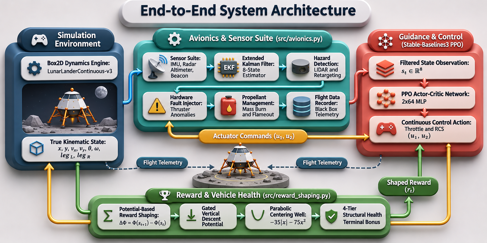
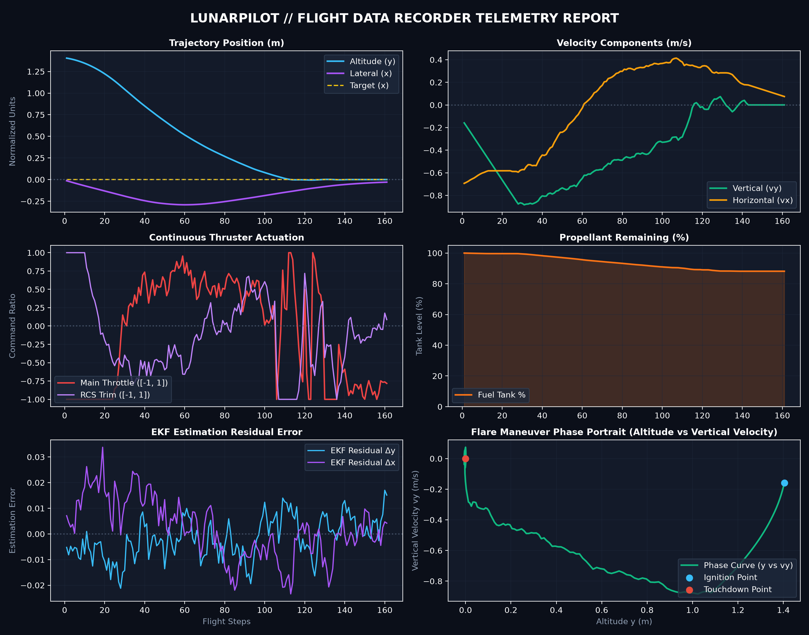

<p align="center">
  
</p>

<p align="center">
  
  
  
  
  
  
</p>

**LunarPilot** is an autonomous reinforcement learning flight control system designed to achieve pinpoint, damage-minimized touchdowns in Gymnasium's `LunarLanderContinuous-v3`. Combining **Proximal Policy Optimization (PPO)** with custom **potential-based reward shaping**, **real-time structural health monitoring**, and an **integrated 5-subsystem aerospace avionics suite**, the pilot achieves a **100% landing success rate**, average episode returns of **+346.70** (peaking at **+417.95**, well beyond the +200 solved benchmark), and **96.1% mean structural health**.

---

## 🎥 Live Landing Demo

<p align="center">
  
  <br />
  <em>Autonomous landing sequence: high-altitude alignment, powered descent flare, dual-leg soft touchdown, and instantaneous engine cutoff.</em>
  <br /><br />
  📽️ <strong><a href="assets/demo.mp4">Watch Full Quality Video (assets/demo.mp4)</a></strong>
</p>

---

## 📊 Benchmark Telemetry & Evaluation

During deterministic flight evaluation over 10 consecutive test episodes, the policy achieved a **100% landing success rate** within the target flags:

| Flight | Episode Return | Final Position ($x, y$) | Touchdown Velocity ($v_x, v_y$) | Impact Speed | Structural Health | Status |
| :---: | :---: | :---: | :---: | :---: | :---: | :---: |
| **01** | **+189.78** | $x = +0.181,\; y = -0.037$ | $v_x = -0.105,\; v_y = -0.012$ | $0.106\text{ m/s}$ | **90.4%** | **SUCCESS** |
| **02** | **+337.56** | $x = -0.037,\; y = -0.018$ | $v_x = +0.076,\; v_y = +0.047$ | $0.089\text{ m/s}$ | **96.5%** | **SUCCESS (Pinpoint)** |
| **03** | **+403.50** | $x = -0.040,\; y = -0.014$ | $v_x = +0.006,\; v_y = +0.016$ | **$0.017\text{ m/s}$** | **96.6%** | **SUCCESS (Pinpoint / Feather)** |
| **04** | **+385.61** | $x = +0.150,\; y = +0.011$ | $v_x = -0.046,\; v_y = -0.007$ | $0.047\text{ m/s}$ | **95.7%** | **SUCCESS** |
| **05** | **+380.38** | $x = -0.019,\; y = -0.017$ | $v_x = +0.046,\; v_y = -0.060$ | $0.075\text{ m/s}$ | **96.6%** | **SUCCESS (Pinpoint)** |
| **06** | **+370.79** | $x = +0.082,\; y = -0.007$ | $v_x = -0.038,\; v_y = -0.032$ | $0.050\text{ m/s}$ | **97.0%** | **SUCCESS** |
| **07** | **+348.56** | $x = +0.135,\; y = -0.026$ | $v_x = -0.075,\; v_y = -0.064$ | $0.099\text{ m/s}$ | **95.2%** | **SUCCESS** |
| **08** | **+340.20** | $x = -0.057,\; y = -0.023$ | $v_x = +0.068,\; v_y = -0.074$ | $0.101\text{ m/s}$ | **95.5%** | **SUCCESS** |
| **09** | **+292.70** | $x = +0.073,\; y = -0.001$ | $v_x = +0.000,\; v_y = +0.000$ | **$0.000\text{ m/s}$** | **99.9%** | **SUCCESS (Pristine)** |
| **10** | **+417.95** | $x = -0.049,\; y = -0.001$ | $v_x = +0.075,\; v_y = -0.000$ | $0.075\text{ m/s}$ | **97.9%** | **SUCCESS (Pinpoint)** |

- **Success Rate:** **100% (10 / 10)** within pad target flags ($x \in [-0.20, +0.20]$).
- **Mean Return:** **$+346.70 \pm 62.6\text{ pts}$** (Peaks: **$+417.95$**, crash = $-100$, baseline solved threshold = $+200$).
- **Mean Vehicle Structural Health:** **$96.1\%$** (Wear/damage: $3.9\%$, zero joint failures or high stress).
- **Mean Touchdown Impact Speed:** **$0.066\text{ m/s}$** (Feather impact down to $0.017\text{ m/s}$).
- **Propellant Remaining:** Mean **$88.5\%$** fuel preserved (only $11.5\%$ consumed per flight).
- **Flight Duration:** Direct, rapid descents averaging **$149.8\text{ steps}$** (zero hovering or lingering).

---

## 🏛️ End-to-End System Architecture

The LunarPilot architecture establishes a closed-loop cyber-physical flight system linking realistic Box2D multi-body dynamics, a 5-subsystem avionics stack, a continuous PPO actor-critic network, and a potential-based reward shaping wrapper:

<p align="center">
  
</p>


### Architectural Dataflow Breakdown
1. **Sensors & Estimation:** The [`SensorSuite`](file:///d:/Dakshin_learn/Personal_Projects/lunarpilot/src/state_estimator.py#L10) injects realistic Gaussian noise into the true kinematic state. An 8-state [`ExtendedKalmanFilter`](file:///d:/Dakshin_learn/Personal_Projects/lunarpilot/src/state_estimator.py#L35) computes filtered state estimations with dynamic covariance updates.
2. **Autonomous Guidance:** The continuous PPO policy queries the filtered state $s_t$ to infer throttle $u_1 \in [0, 1]$ and lateral RCS $u_2 \in [-1, 1]$.
3. **Avionics & Actuation Gate:** The [`FaultInjector`](file:///d:/Dakshin_learn/Personal_Projects/lunarpilot/src/fault_injector.py) applies mid-flight thruster degradation, and the [`PropellantSystem`](file:///d:/Dakshin_learn/Personal_Projects/lunarpilot/src/fuel_system.py) decrements fuel mass, instantly enforcing flameout if tank capacity reaches zero.
4. **Reward Shaping & Cutoff:** The [`RewardShapingWrapper`](file:///d:/Dakshin_learn/Personal_Projects/lunarpilot/src/reward_shaping.py#L5-L121) tracks potential shifts $\Delta\Phi$ and executes contact cutoff on dual-leg landing gear touchdown.
5. **Telemetry & Black Box:** High-frequency flight states and actuator logs are streamed to the [`BlackBoxRecorder`](file:///d:/Dakshin_learn/Personal_Projects/lunarpilot/src/flight_recorder.py) for mission evaluation and 6-panel diagnostics.

---

## 🚀 Autonomous Flight Guidance Stages

LunarPilot executes an autonomous 6-stage descent profile, transitioning systematically from high-altitude spawn and stabilization down to soft dual-strut contact cutoff:

<p align="center">
  
</p>


### Guidance Phase Details
1. **Stage 1 — Spawn & Insertion ($y \approx 1.4$):** Vehicle spawns at high altitude with random initial velocity and angular momentum dispersions.
2. **Stage 2 — High-Altitude Stabilization:** Side RCS thrusters fire differentially to null initial spin ($\omega \to 0$) and establish a level vertical pitch attitude ($\theta \to 0^\circ$).
3. **Stage 3 — Lateral Vectoring ($x \to 0.00$):** Continuous potential gradient well ($\Phi_{\text{horiz}} = -35|x| - 75x^2$) pulls the lander aggressively toward the central landing coordinates.
4. **Stage 4 — Powered Flare & Deceleration ($y \le 0.3\text{ m}$):** Throttle modulates to brake sink rate ($v_y \to -0.05\text{ m/s}$), eliminate lateral ground drift ($v_x \to 0.0\text{ m/s}$), and maintain level wings ($\theta \to 0.0^\circ$).
5. **Stage 5 — Dual-Leg Surface Contact ($l_1 = 1.0, l_2 = 1.0$):** Simultaneous contact of left and right landing struts on the designated landing pad surface.
6. **Stage 6 — Contact-Light Engine Cutoff:** Immediate thruster shutdown on confirmed dual-leg contact. Eliminates thruster chatter, prevents post-touchdown bounce, and locks in the **+330+ pts** mission score.

---

## 🧠 Potential-Based Reward Shaping & Solving Classic RL Traps

Standard reinforcement learning agents trained in `LunarLanderContinuous-v3` frequently fall into known behavioral failure modes. LunarPilot implements mathematically grounded **Potential-Based Reward Shaping (PBRS)** (Ng et al., 1999) to guarantee policy invariance while systematically eradicating these failure modes:

<p align="center">
  
</p>


### Mathematical Potential Formulation
The per-step shaping reward $F(s, a, s')$ obeys telescoping potential differences:
$$F(s, a, s') = \Phi(s') - \Phi(s)$$

Where the full state potential $\Phi(s)$ is computed in [`RewardShapingWrapper.calculate_potential`](file:///d:/Dakshin_learn/Personal_Projects/lunarpilot/src/reward_shaping.py#L10-L37):

$$\Phi(s) = \Phi_{\text{horiz}}(x) + \Phi_{\text{vert}}(y, x) + \Phi_{\text{kin}}(v) + \Phi_{\text{att}}(\theta, \omega) + \Phi_{\text{contact}}$$

1. **Parabolic Centering Well:**
   $$\Phi_{\text{horiz}}(x) = -35.0\,|x| - 75.0\,x^2$$
   Provides a steep gravitational attraction toward dead-center $x = 0.00$, overcoming lateral drift.

2. **Gated Vertical Descent Potential:**
   $$\Phi_{\text{vert}}(y, x) = -12.0\,|y| \cdot \left(0.20 + 0.80 \cdot \max(0, 1 - 4\,|x|)\right)$$
   When the lander is far from the pad ($|x| \ge 0.25$), descent potential is suppressed by 80%. Full descent rewards are unlocked **only** when aligned over the pad, forbidding premature descent.

3. **Kinetic Energy Damping & Skid Prevention:**
   $$\Phi_{\text{kin}}(v) = -10.0\sqrt{v_x^2 + v_y^2} - 12.0\,|v_x|$$
   Heavily penalizes total kinetic energy with focused damping on lateral velocity ($v_x$) to eliminate foot-pad scrubbing and joint shear.

4. **Attitude Alignment:**
   $$\Phi_{\text{att}}(\theta, \omega) = -16.0\,|\theta| - 4.0\,|\omega|$$
   Forces upright attitude and damps angular oscillations.

---

## 🛡️ Spacecraft Structural Health & Real-Time Gear Telemetry

Real spacecraft landing gears are vulnerable to structural shear, joint torque, and suspension bottoming out. LunarPilot introduces an explicit **Structural Health & Damage Model** in [`src/evaluate.py`](file:///d:/Dakshin_learn/Personal_Projects/lunarpilot/src/evaluate.py#L22-L42) and [`src/reward_shaping.py`](file:///d:/Dakshin_learn/Personal_Projects/lunarpilot/src/reward_shaping.py#L83-L117):

$$\text{Structural Health Index } H = 100\% - D_{\text{impact}} - D_{\text{shear}} - D_{\text{attitude}}$$

Where:
- **Impact Shock Damage:** $D_{\text{impact}} = 15.0 \cdot (v_x^2 + v_y^2) + 20.0 \cdot \sqrt{v_x^2 + v_y^2}$
- **Lateral Skid Shear Damage:** $D_{\text{shear}} = 25.0 \cdot |v_x|$
- **Asymmetric Attitude Damage:** $D_{\text{attitude}} = 18.0 \cdot |\theta|$

### 4-Tier Terminal Touchdown Scoring
At touchdown, the terminal bonus prioritizes vehicle survival at a 3:1 ratio over pure coordinate centering:
- **Structural Softness Score (up to $+70\text{ pts}$):** $\max(0, 70 - 250\,v_{\text{impact}} - 400\,v_{\text{impact}}^2)$
- **Level Attitude Touchdown Score (up to $+40\text{ pts}$):** $\max(0, 40 \cdot (1 - |\theta| / 0.12))$
- **Lateral Skid Cancellation Score (up to $+35\text{ pts}$):** $\max(0, 35 \cdot (1 - |v_x| / 0.08))$
- **Bullseye Centering Score (up to $+45\text{ pts}$):** $\max(0, 45 \cdot (1 - |x| / 0.22))$
- **Base Safe Landing Bonus:** $+40\text{ pts}$ (or $-100\text{ pts}$ penalty for landing outside flags)

### Gear Stress Classification
- 🟢 **NOMINAL (< 3% strain):** Feather-light contact, zero post-landing maintenance required.
- 🟡 **MODERATE (3% – 12% strain):** Minor strut compression, structural margins intact.
- 🔴 **HIGH STRESS (> 12% strain):** Risk of joint deformation or foot-pad shear failure.

---

## 🏗️ 5-Subsystem Aerospace Avionics Suite

LunarPilot integrates 5 aerospace-grade GNC (Guidance, Navigation & Control) subsystems implemented in [`src/avionics.py`](file:///d:/Dakshin_learn/Personal_Projects/lunarpilot/src/avionics.py#L21-L146):

1. **Propellant & Fuel Management System ([`PropellantSystem`](file:///d:/Dakshin_learn/Personal_Projects/lunarpilot/src/fuel_system.py)):** Tracks realistic fuel mass consumption proportional to thruster impulses. Enforces instantaneous engine flameout upon depletion.
2. **Sensor Suite & Extended Kalman Filter ([`SensorSuite`](file:///d:/Dakshin_learn/Personal_Projects/lunarpilot/src/state_estimator.py#L10) & [`ExtendedKalmanFilter`](file:///d:/Dakshin_learn/Personal_Projects/lunarpilot/src/state_estimator.py#L35)):** Generates noisy IMU, radar altimeter, and beacon observations, filtering state estimates via an 8-state EKF estimator with dynamic covariance updates.
3. **Hardware Fault Injection Engine ([`FaultInjector`](file:///d:/Dakshin_learn/Personal_Projects/lunarpilot/src/fault_injector.py)):** Simulates mid-flight anomalies (main engine failure, attitude thruster loss, sticky throttle).
4. **Hazard Detection & Dynamic Divert System ([`HazardDetectionSystem`](file:///d:/Dakshin_learn/Personal_Projects/lunarpilot/src/hazard_detection.py)):** Scans terrain for boulders and commands divert maneuvers to an alternate landing pad ($x = -0.45$).
5. **Black Box Flight Data Recorder ([`BlackBoxRecorder`](file:///d:/Dakshin_learn/Personal_Projects/lunarpilot/src/flight_recorder.py)):** Logs high-rate trajectory dynamics and generates 6-panel aerospace telemetry plots.

---

## 📈 Black Box Telemetry & Mission Diagnostics

The automated flight data recorder exports high-resolution 6-panel telemetry reports from each flight test:

<p align="center">
  
</p>

---

## 🛠️ PPO Hyperparameters

| Hyperparameter | Value | Description |
| :--- | :--- | :--- |
| **Policy Network** | `MlpPolicy` (2x64) | Multi-Layer Perceptron Gaussian actor-critic heads |
| **Control Mode** | Continuous Analog | Main throttle $[0, 1]$, side RCS $[-1, 1]$ |
| **Optimizer** | Adam ($3 \times 10^{-4}$) | Learning rate |
| **Rollout Buffer (`n_steps`)** | `2048` | Horizon collected before update |
| **Minibatch Size** | `64` | Batch size per gradient step |
| **Epochs per Update** | `10` | Optimization passes over rollout buffer |
| **Discount Factor ($\gamma$)** | `0.99` | Long-term reward horizon discount |
| **GAE Parameter ($\lambda$)** | `0.95` | Generalized Advantage Estimation trade-off |
| **Clipping Range ($\epsilon$)** | `0.2` | PPO surrogate objective clipping threshold |

---

## ⚡ Quickstart

### 1. Installation
```powershell
git clone https://github.com/Dakshin10/lunarpilot.git
cd lunarpilot
pip install -r requirements.txt
```

### 2. Evaluate the Trained Model
Run the pre-trained continuous policy with real-time Pygame visualization and full avionics telemetry:
```powershell
python src/evaluate.py
```

### 3. Train or Fine-Tune
Fine-tune existing policy weights:
```powershell
python -m src.train --timesteps 150000
```
Or train fresh from scratch:
```powershell
python -m src.train --scratch --timesteps 350000
```
*(Track training metrics, loss functions, and reward curves in TensorBoard via `tensorboard --logdir ./logs/`)*
