<p align="center">
  
</p>

<p align="center">
  
  
  
  
  
  
</p>

**LunarPilot** is an autonomous reinforcement learning flight control system designed to achieve pinpoint, damage-minimized touchdowns in Gymnasium's `LunarLanderContinuous-v3`. Combining **Proximal Policy Optimization (PPO)** with custom **potential-based reward shaping**, **real-time structural health monitoring**, and an **integrated 5-subsystem aerospace avionics suite**, the pilot achieves a **100% landing success rate**, average episode returns of **+346.70** (peaking at **+417.95**, well beyond the +200 solved benchmark), and **96.1% mean structural health**.

---

## 🎥 Live Landing Demo

<p align="center">
  
  <br />
  <em>Autonomous landing sequence: high-altitude alignment, powered descent flare, dual-leg soft touchdown, and instantaneous engine cutoff.</em>
  <br /><br />
  📽️ <strong><a href="assets/demo.mp4">Watch Full Quality Video (assets/demo.mp4)</a></strong>
</p>

---

## 📊 Benchmark Telemetry & Evaluation

During deterministic flight evaluation over 10 consecutive test episodes, the policy achieved a **100% landing success rate** within the target flags:

| Flight | Episode Return | Final Position ($x, y$) | Touchdown Velocity ($v_x, v_y$) | Impact Speed | Structural Health | Status |
| :---: | :---: | :---: | :---: | :---: | :---: | :---: |
| **01** | **+189.78** | $x = +0.181,\; y = -0.037$ | $v_x = -0.105,\; v_y = -0.012$ | $0.106\text{ m/s}$ | **90.4%** | **SUCCESS** |
| **02** | **+337.56** | $x = -0.037,\; y = -0.018$ | $v_x = +0.076,\; v_y = +0.047$ | $0.089\text{ m/s}$ | **96.5%** | **SUCCESS (Pinpoint)** |
| **03** | **+403.50** | $x = -0.040,\; y = -0.014$ | $v_x = +0.006,\; v_y = +0.016$ | **$0.017\text{ m/s}$** | **96.6%** | **SUCCESS (Pinpoint / Feather)** |
| **04** | **+385.61** | $x = +0.150,\; y = +0.011$ | $v_x = -0.046,\; v_y = -0.007$ | $0.047\text{ m/s}$ | **95.7%** | **SUCCESS** |
| **05** | **+380.38** | $x = -0.019,\; y = -0.017$ | $v_x = +0.046,\; v_y = -0.060$ | $0.075\text{ m/s}$ | **96.6%** | **SUCCESS (Pinpoint)** |
| **06** | **+370.79** | $x = +0.082,\; y = -0.007$ | $v_x = -0.038,\; v_y = -0.032$ | $0.050\text{ m/s}$ | **97.0%** | **SUCCESS** |
| **07** | **+348.56** | $x = +0.135,\; y = -0.026$ | $v_x = -0.075,\; v_y = -0.064$ | $0.099\text{ m/s}$ | **95.2%** | **SUCCESS** |
| **08** | **+340.20** | $x = -0.057,\; y = -0.023$ | $v_x = +0.068,\; v_y = -0.074$ | $0.101\text{ m/s}$ | **95.5%** | **SUCCESS** |
| **09** | **+292.70** | $x = +0.073,\; y = -0.001$ | $v_x = +0.000,\; v_y = +0.000$ | **$0.000\text{ m/s}$** | **99.9%** | **SUCCESS (Pristine)** |
| **10** | **+417.95** | $x = -0.049,\; y = -0.001$ | $v_x = +0.075,\; v_y = -0.000$ | $0.075\text{ m/s}$ | **97.9%** | **SUCCESS (Pinpoint)** |

- **Success Rate:** **100% (10 / 10)** within pad target flags ($x \in [-0.20, +0.20]$).
- **Mean Return:** **$+346.70 \pm 62.6\text{ pts}$** (Peaks: **$+417.95$**, crash = $-100$, baseline solved threshold = $+200$).
- **Mean Vehicle Structural Health:** **$96.1\%$** (Wear/damage: $3.9\%$, zero joint failures or high stress).
- **Mean Touchdown Impact Speed:** **$0.066\text{ m/s}$** (Feather impact down to $0.017\text{ m/s}$).
- **Propellant Remaining:** Mean **$88.5\%$** fuel preserved (only $11.5\%$ consumed per flight).
- **Flight Duration:** Direct, rapid descents averaging **$149.8\text{ steps}$** (zero hovering or lingering).

---

## 🛡️ Spacecraft Structural Health & Damage Minimization

Real spacecraft landing gears are vulnerable to structural shear, joint torque, and suspension bottoming out. LunarPilot introduces a **Structural Health & Damage Model** that tracks mechanical load in real-time across four critical flight metrics:

1. **Touchdown Kinetic Energy Shock ($E_k \propto \frac{1}{2}m v^2$):** Penalizes high vertical and horizontal touchdown velocities to cushion strut compression.
2. **Ground Skid Friction Shear ($\propto |v_x|$):** Penalizes lateral drift at touchdown, preventing foot-pad scrubbing and revolute joint shear stress.
3. **Asymmetric Touchdown Torque ($\propto |\theta| + |\omega|$):** Penalizes tilted touchdowns, compelling level wings ($\theta \approx 0^\circ$) so both legs contact simultaneously rather than slamming a single strut.
4. **Parabolic Centering Attraction:** Funnels the craft toward dead-center ($x = 0.00$) without sacrificing touchdown softness.

### Multi-Criteria Reward Balancing
To eliminate the exploit where an agent rushes into the center while slamming down sideways, the reward function values **Structural Health ($+145\text{ pts}$)** at a 3:1 ratio over pure **Centering ($+45\text{ pts}$)**:
- **Structural Softness Score:** Up to $+70\text{ pts}$
- **Level Attitude Touchdown Score:** Up to $+40\text{ pts}$
- **Lateral Skid Cancellation Score:** Up to $+35\text{ pts}$
- **Bullseye Centering Score:** Up to $+45\text{ pts}$
- **Base Safe Landing Bonus:** $+40\text{ pts}$

---

## 🏗️ 5-Subsystem Aerospace Avionics Suite

LunarPilot integrates 5 aerospace-grade GNC (Guidance, Navigation & Control) subsystems:

1. **Propellant & Fuel Management System:** Realistic fuel mass consumption tracking and flameout simulation upon exhaustion.
2. **Sensor Suite & Extended Kalman Filter (EKF):** Generates noisy IMU, radar altimeter, and beacon observations, filtering state estimates via an 8-state EKF estimator.
3. **Hardware Fault Injection Engine:** Injects mid-flight thruster anomalies (main engine failure, attitude thruster loss, sticky throttle).
4. **Hazard Detection & Dynamic Divert System:** Scans terrain for boulders and commands divert maneuvers to an alternate landing pad ($x = -0.45$).
5. **Black Box Flight Data Recorder (FDR):** Logs high-rate trajectory dynamics and generates 6-panel aerospace telemetry plots.

---

## 📈 Black Box Telemetry & Mission Diagnostics

The automated flight data recorder exports high-resolution 6-panel telemetry reports from each flight test:

<p align="center">
  
</p>

---

## 🛠️ PPO Hyperparameters

| Hyperparameter | Value | Description |
| :--- | :--- | :--- |
| **Policy Network** | `MlpPolicy` (2x64) | Multi-Layer Perceptron Gaussian actor-critic heads |
| **Control Mode** | Continuous Analog | Main throttle $[0, 1]$, side RCS $[-1, 1]$ |
| **Optimizer** | Adam ($3 \times 10^{-4}$) | Learning rate |
| **Rollout Buffer (`n_steps`)** | `2048` | Horizon collected before update |
| **Minibatch Size** | `64` | Batch size per gradient step |
| **Epochs per Update** | `10` | Optimization passes over rollout buffer |
| **Discount Factor ($\gamma$)** | `0.99` | Long-term reward horizon discount |
| **GAE Parameter ($\lambda$)** | `0.95` | Generalized Advantage Estimation trade-off |
| **Clipping Range ($\epsilon$)** | `0.2` | PPO surrogate objective clipping threshold |

---

## ⚡ Quickstart

### 1. Installation
```powershell
git clone https://github.com/Dakshin10/lunarpilot.git
cd lunarpilot
pip install -r requirements.txt
```

### 2. Evaluate the Trained Model
Run the pre-trained continuous policy with real-time Pygame visualization and full avionics telemetry:
```powershell
python src/evaluate.py
```

### 3. Train or Fine-Tune
Fine-tune existing policy weights:
```powershell
python -m src.train --timesteps 150000
```
Or train fresh from scratch:
```powershell
python -m src.train --scratch --timesteps 350000
```
*(Track training metrics, loss functions, and reward curves in TensorBoard via `tensorboard --logdir ./logs/`)*
